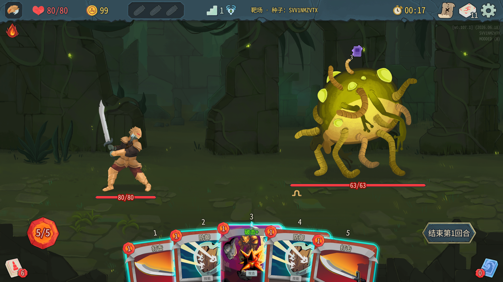
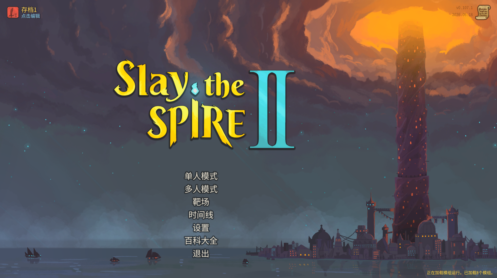
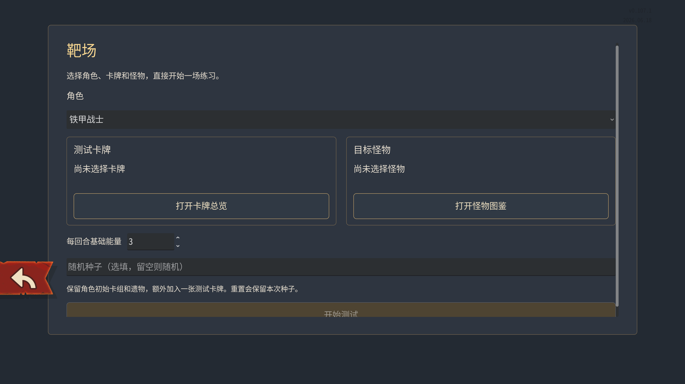
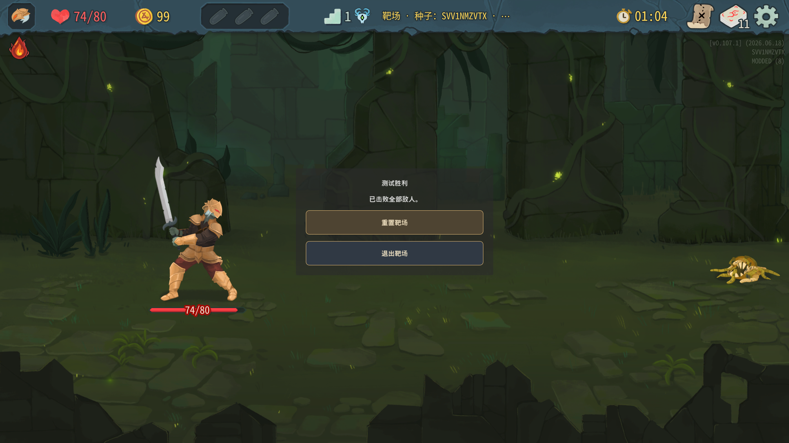

# 靶场 / Spire Range

《杀戮尖塔 2》卡牌测试 Mod。选择角色、卡牌和怪物，直接开始练习战斗，无需从头打一局冒险。



## 功能

- 自选角色、测试卡牌和目标怪物，支持选择升级版卡牌。
- 卡牌支持分类筛选和搜索，怪物可按地图浏览。
- 自定义每回合基础能量，使用随机种子或指定种子。
- 一键重置当前战斗，保留配置和种子。

## 安装

适用游戏版本：**v0.107.1**。

1. 关闭游戏。
2. 将安装包中的 `SpireRange` 文件夹放入游戏安装目录的 `mods` 文件夹，没有则新建。
3. 启动游戏并启用「靶场 / Spire Range」。如果提示重启，重启游戏后生效。

确认文件位置如下：

```text
Slay the Spire 2/
└─ mods/
   └─ SpireRange/
      ├─ SpireRange.dll
      └─ SpireRange.json
```

更新时，关闭游戏并替换这两个文件。

## 开始练习

在主菜单点击「靶场」。



选择角色，打开卡牌总览和怪物图鉴，确认要测试的卡牌及目标。在卡牌详情中勾选「查看升级」，即可选择升级版卡牌。设置好基础能量后，点击「开始测试」。种子可留空随机，也可填写指定值。



每场战斗使用**角色初始卡组 + 1 张测试卡牌**，保留初始遗物。测试卡牌参与正常洗牌和抽牌，不保证出现在起手中。

战斗中按 **Esc**，选择「重置靶场」重新开始，或「退出靶场」返回主菜单。重置会保留本次配置和种子；想换一组随机结果，可返回主菜单，种子留空再开始。

胜利后，也可以直接在结算面板重置或退出。



## 兼容说明

- 目前支持单人练习，不保存本局冒险进度。
- 部分依赖同伴或特殊遭遇的怪物，单独测试时可能与正常冒险中的表现不同。

## 问题反馈

请在 [Issues](https://github.com/BabyB1u3/StS2_Range/issues) 提交问题，附上游戏版本、角色、卡牌、怪物、随机种子和复现步骤；有报错时请一并提供截图或日志。
